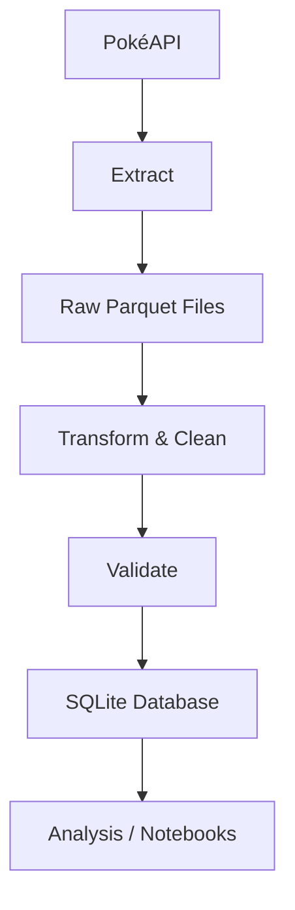

# Pokémon Data Analytics ETL Pipeline

An end-to-end ETL pipeline built using Pokémon data from the [PokéAPI](https://pokeapi.co/).

The project extracts Pokémon, species, and move data, stores the raw responses in Parquet, transforms and validates the data, and loads the processed data into a normalized SQLite database.

## Problem Statement

Public REST APIs such as PokéAPI offer rich, deeply nested datasets covering Pokémon species, moves, abilities, forms, and battle statistics. However, utilizing this API directly for analytical workloads presents multiple engineering challenges:

1. **Complex Nested JSON**: Payloads contain polymorphic arrays and deeply nested dictionaries that cannot be queried directly using standard relational SQL.
2. **Rate Limits & API Latency**: Making hundreds of sequential HTTP calls is slow and susceptible to rate-limiting (HTTP 429) or transient server drops (HTTP 500/502/503).
3. **Repeated Network Overhead**: Running transformations directly against live API endpoints requires repetitive network calls, slowing down testing and analytical iteration.
4. **Data Quality & Relational Integrity**: Without automated data validation and relational constraints (primary/foreign keys), datasets risk null-value corruptions and referential drift.

## Steps to Solve the Problem

To solve these challenges, this project implements a robust, modular ETL pipeline following modern data engineering practices:

1. **Step 1: Resilient Multi-Threaded Extraction (`extract.py`)**
   - Configures connection pooling and exponential backoff retry strategies (`requests.adapters.HTTPAdapter`) to reliably handle rate limits and transient connection errors.
   - Leverages `ThreadPoolExecutor` for concurrent API calls, accelerating data extraction.
2. **Step 2: Raw Data Landing Layer (`load_raw.py`)**
   - Implements a Data Lake pattern by persisting raw JSON responses into compressed Snappy Parquet files (`raw/`).
   - Decouples extraction from transformation, allowing reproducible pipelines without repeatedly querying the API.
3. **Step 3: Data Transformation & Feature Engineering (`transform.py`, `transform_runner.py`)**
   - Flattens complex JSON hierarchies into clean tabular formats with Pandas.
   - Derives analytical features such as total base stats, offensive/defensive power, speed percentiles, size classes, and battle styles.
4. **Step 4: Automated Data Quality Validation (`validation.py`)**
   - Implements rigorous validation rules: verifies mandatory schema columns, checks non-negative numeric constraints, and validates categorical boundaries.
5. **Step 5: Normalized Relational Database Loading (`load.py`, `schema.sql`)**
   - Creates a normalized 3NF relational schema in SQLite (`pokemon`, `pokemon_species`, `pokemon_types`, `pokemon_abilities`, `moves`, `pokemon_moves`).
   - Enforces primary keys, foreign keys, and indexes for fast analytical query execution.
6. **Step 6: Analysis, Verification & Interactive Exploration (`notebooks/`, `tests/`)**
   - Delivers interactive Jupyter notebooks demonstrating extraction benchmarks, data cleaning step-by-step, database schema exploration, and exploratory queries.
   - Integrates automated tests verifying failure-handling and retry mechanics.

## Technologies & Techniques

- **Python** — pipeline development
- **Requests** — API extraction
- **ThreadPoolExecutor** — parallel API requests
- **Pandas** — data transformation and analysis
- **PyArrow / Parquet** — raw data storage
- **SQLite** — processed data storage
- **SQL** — database queries
- **Pytest** — testing
- **Jupyter Notebook** — demonstrations and analysis
- **Binder** — browser-based project demo
- **Retry & backoff** — handling temporary API failures
- **Data validation** — checking data quality and relationships

## Architecture



```text
PokéAPI
   ↓
Extract
   ↓
Raw Parquet Files
   ↓
Transform & Clean
   ↓
Validate
   ↓
SQLite Database
   ↓
Analysis / Notebooks
```

The extraction layer uses parallel requests to reduce API extraction time. Raw data is preserved separately from the processed data so that transformations can be reproduced without repeatedly calling the API.

## Project Structure

```text
pokemon-data-pipeline/
│
├── notebooks/
│   ├── database_walkthrough.ipynb
│   ├── extraction_demo.ipynb
│   ├── project_demo.ipynb
│   └── transformation_demo.ipynb
├── raw/
│   ├── moves.parquet
│   ├── pokemon.parquet
│   └── species.parquet
├── schema/
│   ├── retrieve.py
│   └── schema.py
├── tests/
│   ├── __init__.py
│   ├── test_failure.py
│   └── test_retry.py
├── logs/
│   └── .gitkeep
│
├── config.py
├── extract.py
├── load_raw.py
├── transform.py
├── transform_runner.py
├── validation.py
├── load.py
├── main.py
├── schema.sql
├── schema.txt
├── retrieve.txt
├── requirements.txt
├── runtime.txt
├── .gitignore
└── pokemon.db
```

## Setup & Running

Clone the repository and install the required dependencies:

```bash
git clone https://github.com/Ankitkumar1141/pokemon-data-pipeline.git
cd pokemon-data-pipeline
pip install -r requirements.txt
```

Run the complete pipeline:

```bash
python main.py
```

Run tests:

```bash
python -m pytest tests/
```

The pipeline extracts the required API data, stores the raw data in Parquet, transforms and validates it, and loads the processed data into `pokemon.db`.

Configuration such as API settings, retry behaviour, database path, and transformation-related constants is maintained in `config.py`.

## Database

The processed data is stored in a normalized SQLite database containing:

- `pokemon_species`
- `pokemon`
- `pokemon_types`
- `pokemon_abilities`
- `moves`
- `pokemon_moves`

The complete database structure, keys, relationships, constraints, and example queries are demonstrated in:

```text
notebooks/database_walkthrough.ipynb
```

## Binder Demo

The project can be run interactively in the browser using **Binder**, without setting up the project locally.

Launch the repository through Binder and open:

```text
notebooks/project_demo.ipynb
```

The notebook provides an interactive environment for exploring the project and its processed data.

Additional notebooks demonstrate the individual stages of the pipeline:

```text
notebooks/extraction_demo.ipynb
notebooks/transformation_demo.ipynb
notebooks/database_walkthrough.ipynb
```

## Author

- **Ankit Kumar**
